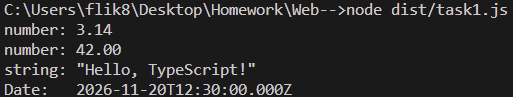
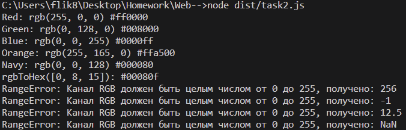
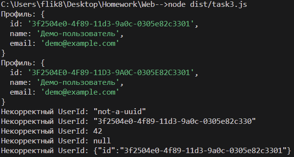
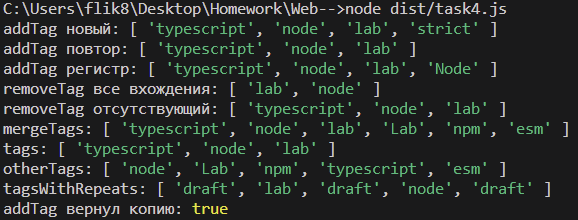
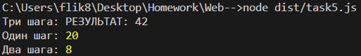

# Лабораторная работа №8 — Основы TypeScript. Практикум в Node.js

---

**Автор:** Вилл Максим, ФИТ-241

## Описание

Консольный TypeScript-проект из девяти задач: типы функций и коллекций, обобщения, утилитарные, условные и сопоставленные типы, класс хранилища. Код проверяется и компилируется через `tsc`, а собранный JavaScript запускается в Node.js.

## Окружение

- Node.js **v26.1.0** (LTS), npm **12.0.2**
- TypeScript и `@types/node` в `devDependencies`
- ES-модули (`"type": "module"`), `module` / `moduleResolution`: `NodeNext`, `strict`, `noEmitOnError`

## Установка и запуск

```sh
npm ci              # установка зависимостей по package-lock.json
npm run check       # проверка типов без сборки
npm run build       # компиляция в dist/
node dist/task1.js  # запуск задачи (номер файла 1–9)
```

### Задание 1


### Задание 2


### Задание 3


### Задание 4


### Задание 5


После изменения исходников повторите `npm run build`.